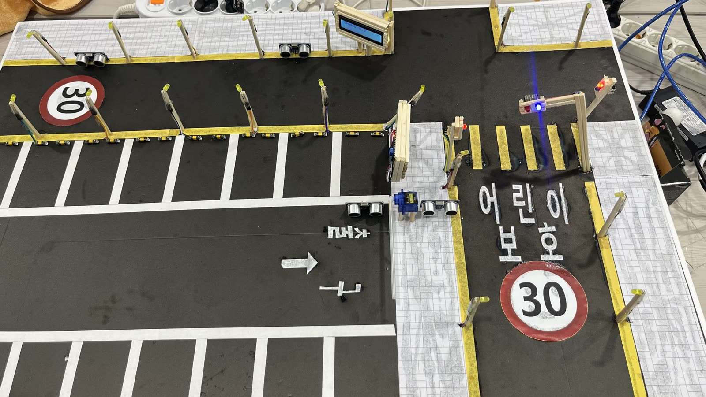
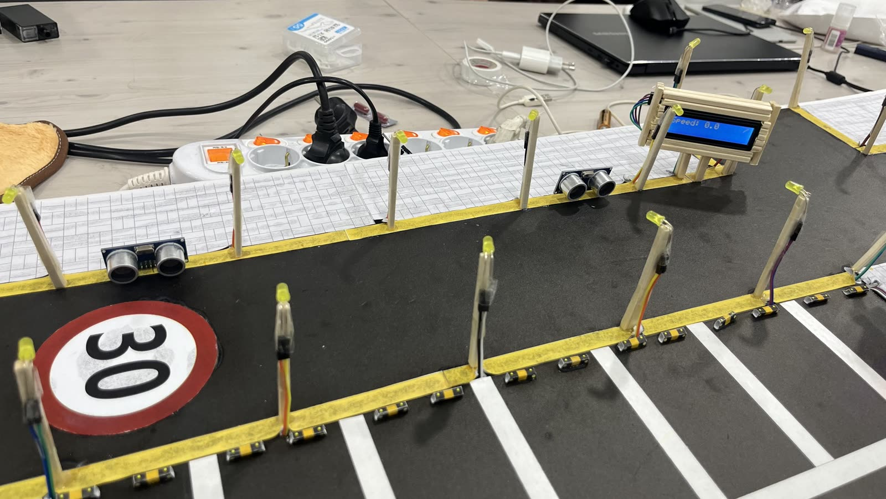
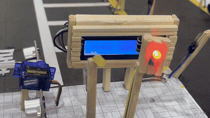
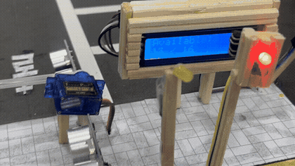
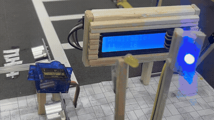
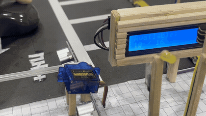
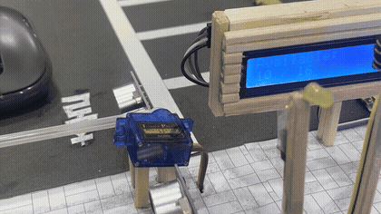
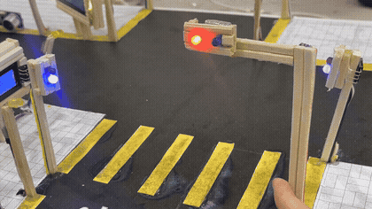
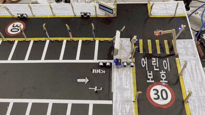

# 🚸 스마트 도로 모형을 통한 교통 시뮬레이션 시스템

> IoT소프트웨어개발 기말 프로젝트 · 팀 **녕차녕차**

**아두이노**로 어린이 보호구역과 주차장이 있는 소형 도로 모형을 만들고, 센서·모터·디스플레이·LED로 실제 도로 상황을 시뮬레이션하고 자동화한 프로젝트입니다.

<p align="center">
  
  
</p>

> ⚠️ **소스 코드 안내** — 원본 코드는 유실되어 이 저장소에는 포함되어 있지 않습니다. 동작 영상, 사진, 계획서로 프로젝트를 기록합니다.

---

## ✨ 주요 기능

| 기능 | 설명 | 사용 부품 |
|---|---|---|
| 🅿️ **주차장 자동 차단기** | 입구의 초음파 센서가 차량을 감지하면 서보모터 차단기가 열리고, 통과 후 닫힘 | 초음파 센서, 서보모터 |
| 🔢 **잔여 주차면 표시** | 입·출차에 따라 남은 주차 공간 수를 LCD에 표시 | LCD |
| 🚗 **과속 측정** | 도로를 따라 설치한 두 초음파 센서의 감지 시간 차로 속도를 계산해 전광판에 표시 | 초음파 센서 ×2, LCD |
| 🚦 **보행자 신호등** | 횡단보도 신호등의 점등 상태 전환 | LED |
| 💡 **자동 가로등** | 주변이 어두워지면 가로등이 자동으로 켜짐 | LED |

### 📝 계획 대비 변경점
처음 계획서에는 온습도 센서와 화재 센서, 그리고 7세그먼트로 속도를 표시하는 기능이 있었습니다. 실제 제작에서는 **과속 측정값과 잔여 주차면을 LCD 전광판에 표시**하는 방식으로 바꿨습니다.

### 🔍 참고한 유사 시스템
- **서울시 스마트 스쿨존** — 속도 감지 카메라, LED 표지판, 신호 제어로 제한 속도를 넘긴 차량에 경고를 표시
- **스마트 주차 관제 시스템** — 초음파·적외선 센서로 차량 출입을 감지해 차단기를 자동으로 개방

---

## 🎬 시연 영상

> GIF는 미리보기이며, 제목을 누르면 원본 영상(mp4)을 볼 수 있습니다.

### 전체 동작
[**01. 전체 동작**](media/videos/01_overview.mp4)



### 🅿️ 주차장 차단기 & 잔여 주차면
| [02. 차단기 A](media/videos/02_parking_gate_a.mp4) | [03. 차단기 B](media/videos/03_parking_gate_b.mp4) |
|---|---|
|  |  |

| [04. 잔여 주차면 LCD](media/videos/04_parking_count_lcd.mp4) | [05. 차단기 C](media/videos/05_parking_gate_c.mp4) |
|---|---|
|  |  |

### 🚦 횡단보도 신호등 & 💡 야간 가로등
| [06. 보행자 신호등](media/videos/06_crosswalk_signal.mp4) | [07. 야간 자동 가로등](media/videos/07_streetlight_night.mp4) |
|---|---|
|  |  |

---

## 🗂️ 저장소 구조

```
smart-school-zone/
├── README.md
├── docs/            # 프로젝트 계획서 (.hwp)
└── media/
    ├── photos/      # 모형 사진
    ├── videos/      # 시연 영상 (mp4)
    └── gifs/        # README 미리보기용 GIF
```

---

## 👥 팀 녕차녕차

| 이름 | GitHub |
|---|---|
| 김찬영 | |
| 이유림 | [@urimll](https://github.com/urimll) |

📄 [프로젝트 계획서 (요약본)](docs/기말프로젝트_계획서.hwp)
